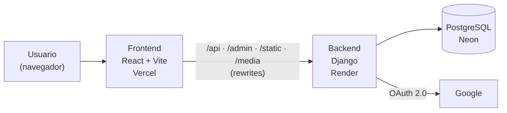

<div align="center">

#  AirByte · Frontend

**Interfaz web para consultar y anticipar la calidad del aire en Bogotá**

React · TypeScript · Vite


[Aplicación en vivo](https://airbyte-eight.vercel.app) ·
[Repositorio del backend](https://github.com/juandiegogalindo/AirByte-Backend) ·
[API](https://airbyte-backend.onrender.com/api/v1/estaciones)

</div>

---

## Tabla de contenidos

1. [Descripción](#descripción)
2. [Características](#características)
3. [Arquitectura](#arquitectura)
4. [Tecnologías](#tecnologías)
5. [Estructura del proyecto](#estructura-del-proyecto)
6. [Instalación local](#instalación-local)
7. [Scripts disponibles](#scripts-disponibles)
8. [Conexión con el backend](#conexión-con-el-backend)
9. [Despliegue en Vercel](#despliegue-en-vercel)
10. [Convenciones del código](#convenciones-del-código)
11. [Solución de problemas](#solución-de-problemas)
12. [Equipo](#equipo)

---

## Descripción

AirByte es una plataforma que permite saber **qué tan contaminado está el aire en Bogotá** y cómo evolucionará durante las próximas 24 horas, a partir de las mediciones de PM2.5 de la Red de Monitoreo de Calidad del Aire de Bogotá (RMCAB) y de un modelo de aprendizaje automático.

Este repositorio contiene el **frontend**: una aplicación de una sola página (SPA) que consume la API del [backend](https://github.com/juandiegogalindo/AirByte-Backend).

## Características

-  **Calidad del aire actual** por estación de monitoreo, con una escala de niveles de fácil lectura.
-  **Pronóstico de las próximas 24 horas** con gráficos horarios y mini-gráficos de tendencia.
-  **Mapa por localidades** para ubicar las estaciones.
-  **Histórico** de mediciones por estación.
-  **Recomendaciones personalizadas** según el nivel de contaminación.
-  **Comunidad**: comentarios y reportes de otros usuarios.
-  **Cuentas de usuario** con inicio de sesión mediante Google y página de perfil.
-  **Panel de administración y moderación** para gestionar usuarios y contenido.
-  **Modo claro y oscuro**.
-  Páginas de **términos y condiciones** y de **error** personalizadas.

<!-- Sugerencia: agrega capturas de pantalla en docs/img/ y enlázalas aquí, por ejemplo:
 -->

## Arquitectura



El frontend se sirve como archivos estáticos desde Vercel. Todas las llamadas a `/api`, `/admin`, `/static` y `/media` se **reenvían al backend** mediante *rewrites*, de modo que el navegador solo habla con un origen. Esto evita configurar CORS y permite que las cookies de sesión funcionen sin ajustes.

## Tecnologías

| Área | Tecnología |
| --- | --- |
| Interfaz | React + TypeScript |
| Empaquetado y servidor de desarrollo | Vite |
| Calidad de código | Oxlint, TypeScript en modo estricto |
| Hosting | Vercel |
| Backend (API) | Django en Render, PostgreSQL en Neon |

## Estructura del proyecto

```text
AirByte-Frontend/
├── docs/                          # Documentación del proyecto
├── frontend/
│   ├── public/                    # Recursos estáticos
│   ├── src/
│   │   ├── assets/                # Imágenes y recursos
│   │   ├── components/            # Piezas reutilizables
│   │   │   ├── charts/            #   HourlyChart, Sparkline
│   │   │   ├── LevelScale.tsx     #   Escala de niveles de calidad del aire
│   │   │   ├── LocalityMap.tsx    #   Mapa por localidades
│   │   │   ├── Recommendations.tsx
│   │   │   ├── SiteChrome.tsx     #   Encabezado y pie de página
│   │   │   └── StationDetail.tsx
│   │   ├── pages/                 # Una carpeta por pantalla (con su CSS)
│   │   │   ├── Admin/             #   Usuarios y moderación
│   │   │   ├── Auth/              #   Inicio de sesión y registro con Google
│   │   │   ├── Community/
│   │   │   ├── Current/           #   Calidad del aire actual
│   │   │   ├── Error/
│   │   │   ├── Estados/
│   │   │   ├── Historico/
│   │   │   ├── Profile/
│   │   │   └── Terms/
│   │   ├── services/              # Comunicación con el backend
│   │   │   ├── api.ts
│   │   │   └── auth.ts
│   │   ├── utils/                 # format.ts, nivel.ts
│   │   ├── types/                 # Tipos de TypeScript
│   │   ├── data/                  # localidades.json
│   │   ├── App.tsx
│   │   ├── main.tsx
│   │   └── index.css
│   ├── index.html
│   ├── package.json
│   ├── tsconfig*.json
│   ├── vite.config.ts
│   └── vercel.json                # Rewrites hacia el backend
└── README.md
```

**Criterio de organización:** cada pantalla vive en `pages/` junto a su CSS; lo que se reutiliza en varias pantallas va en `components/`; todo lo que habla con el backend está aislado en `services/`.

## Instalación local

### Requisitos

- **Node.js 20.19 o superior** (se recomienda la versión LTS más reciente)
- npm
- El [backend](https://github.com/juandiegogalindo/AirByte-Backend) en ejecución en `http://127.0.0.1:8000`

### Pasos

```bash
# 1. Clonar el repositorio
git clone https://github.com/juandiegogalindo/AirByte-Frontend.git
cd AirByte-Frontend/frontend

# 2. Instalar dependencias
npm install

# 3. Iniciar el servidor de desarrollo
npm run dev
```

La aplicación queda disponible en <http://localhost:5173>.

> El puerto 5173 es fijo (`strictPort`). Si está ocupado, Vite no cambiará de puerto: libéralo primero. El inicio de sesión con Google está registrado para ese puerto.

No se necesitan variables de entorno: la aplicación llama a rutas relativas (`/api/...`) y Vite las redirige al backend local.

## Scripts disponibles

Ejecútalos desde la carpeta `frontend/`:

| Comando | Descripción |
| --- | --- |
| `npm run dev` | Servidor de desarrollo con recarga en caliente en el puerto 5173. |
| `npm run build` | Revisa los tipos con `tsc -b` y genera la versión de producción en `dist/`. |
| `npm run preview` | Sirve localmente la versión compilada. |
| `npm run lint` | Ejecuta el linter (Oxlint). |

> Antes de subir cambios, corre `npm run build`. A diferencia de `npm run dev`, el *build* revisa **todos** los archivos y detecta imports rotos y errores de tipos de una sola vez.

## Conexión con el backend

### En desarrollo

`vite.config.ts` define un proxy que envía al backend local las rutas de la API:

| Ruta | Destino |
| --- | --- |
| `/api` | `http://127.0.0.1:8000` |
| `/admin/` | `http://127.0.0.1:8000` |
| `/static` | `http://127.0.0.1:8000` |

### En producción

`vercel.json` reenvía esas mismas rutas al backend desplegado en Render:

```json
{
  "rewrites": [
    { "source": "/api/:path*",    "destination": "https://airbyte-backend.onrender.com/api/:path*" },
    { "source": "/admin/:path*",  "destination": "https://airbyte-backend.onrender.com/admin/:path*" },
    { "source": "/static/:path*", "destination": "https://airbyte-backend.onrender.com/static/:path*" },
    { "source": "/media/:path*",  "destination": "https://airbyte-backend.onrender.com/media/:path*" },
    { "source": "/:path*",        "destination": "/index.html" }
  ]
}
```

La última regla devuelve `index.html` para cualquier otra ruta, de modo que la navegación de la SPA funcione al recargar la página o abrir un enlace directo.

> Si cambias la URL del backend, **actualiza las cuatro rutas** de `vercel.json`.

## Despliegue en Vercel

1. En [Vercel](https://vercel.com), elige **Add New → Project** e importa este repositorio.
2. En **Root Directory** selecciona `frontend`.
3. Vercel detecta Vite automáticamente (comando de build `npm run build`, salida `dist`). No hace falta ninguna variable de entorno.
4. Pulsa **Deploy**. Cada `push` a la rama `main` genera un nuevo despliegue de producción.

### Después del primer despliegue

Con el dominio que te asigne Vercel (en este proyecto, `airbyte-eight.vercel.app`) actualiza en el **backend**:

- `DJANGO_ALLOWED_HOSTS` y `DJANGO_CSRF_TRUSTED_ORIGINS`
- `GOOGLE_REDIRECT_URI` y `FRONTEND_URL`

Y registra en Google Cloud, para el cliente OAuth, el origen `https://<tu-dominio>.vercel.app` y el URI de retorno `https://<tu-dominio>.vercel.app/api/v1/auth/google/callback`. Los detalles están en el [README del backend](https://github.com/juandiegogalindo/AirByte-Backend#despliegue).

## Convenciones del código

- **TypeScript** en todo el código de la aplicación; los tipos compartidos viven en `src/types/`.
- Cada pantalla en `pages/<Nombre>/` junto con su hoja de estilos.
- Los componentes reutilizables en `components/`; los gráficos, en `components/charts/`.
- Las llamadas HTTP **solo** pasan por `services/api.ts` y `services/auth.ts`.
- Las funciones auxiliares sin interfaz (formato de fechas y números, cálculo de niveles) en `utils/`.
- Los imports de CSS deben apuntar a la ubicación real del archivo; si mueves un archivo, ejecuta `npm run build` para detectar rutas rotas.

## Solución de problemas

| Síntoma | Causa probable y solución |
| --- | --- |
| `Failed to resolve import "...css"` | La ruta del import ya no coincide con la ubicación del archivo, o tiene espacios dentro de las comillas. Corrígela y vuelve a compilar. |
| La app carga pero no muestra datos | El backend no está en ejecución. Levántalo en el puerto 8000 o comprueba que el servicio de Render esté activo. |
| La primera carga en producción tarda cerca de un minuto | El plan gratuito de Render suspende el servicio por inactividad; es el arranque en frío. |
| `Error 400: redirect_uri_mismatch` al iniciar sesión | El URI de retorno no está registrado, o no coincide exactamente, en Google Cloud. |
| El inicio de sesión funciona en local pero no en producción | Revisa `GOOGLE_REDIRECT_URI`, `FRONTEND_URL` y `DJANGO_CSRF_TRUSTED_ORIGINS` en el backend. |
| Al recargar una página sale un error 404 | Falta la regla final de `vercel.json` que devuelve `index.html`. |
| `Port 5173 is already in use` | Cierra el proceso que usa el puerto: Vite está configurado con `strictPort`. |

## Equipo
Proyecto desarrollado por los participantes en la Universidad Piloto de Colombia (2026-2).

- **Juan Diego Galindo Montenegro** — [@juandiegogalindo](https://github.com/juandiegogalindo)
- **Cristian Cortes Bejarano** — [@CristianCortes1](https://github.com/CristianCortes1).

Datos de calidad del aire: Red de Monitoreo de Calidad del Aire de Bogotá (RMCAB).
